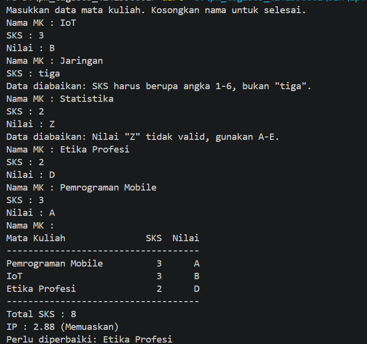

# Pemrograman Mobile - Tugas Rutin 3

Kalkulator IP semester berbasis console, dibuat dengan Dart.

## Identitas
- Nama      : Adinda Soleha
- NIM       : 4242550001
- Kelas     : PSIK 24D
- Matakuliah: Pemrograman Mobile

## Cara Menjalankan
```
dart run bin/ip.dart
```
Masukkan nama mata kuliah, SKS (1-6), dan nilai huruf (A-E). Kosongkan nama untuk selesai.

## Skala yang Digunakan
- Bobot nilai: A = 4, B = 3, C = 2, D = 1, E = 0 (skala contoh dari tugas).
- Predikat IP: Jika >= 3.50, maka Cum Laude (Dengan Pujian); Jika >= 3.01, maka Sangat Memuaskan;Jika >= 2.76, maka Memuaskan; Selain itu akan menghasilkan Tanpa Predikat.
Note: Skala Predikat IP yang saya gunakan menggunakan acuan sendiri bukan dari ketentuan resmi universitas.

## Tangkapan Layar
Satu sesi yang memuat input salah (SKS bukan angka dan nilai tidak valid):



## Penjelasan

Higher-order function saya pakai di tiga tempat. Pertama, fungsi `hitungIp`
memakai `fold` dua kali untuk menjumlahkan total SKS dan total poin
(SKS × bobot), dengan fungsi anonim sebagai argumennya. Kedua, di `main`
saya memakai `where` untuk menyaring mata kuliah berbobot kurang dari 2
ke dalam daftar "perlu diperbaiki". Ketiga, fungsi `cetakKhs` memakai `sort`
dengan fungsi pembanding `b.bobot.compareTo(a.bobot)` agar tabel terurut
dari nilai tertinggi.

Error handling saya terapkan dengan memisahkan tugas. Fungsi `bobot` dan
`validasiSks` hanya memeriksa input dan melempar `FormatException` bila nilai
huruf atau SKS tidak valid. Exception itu ditangkap di `main` dengan `try`
dan `on FormatException catch`, sehingga data yang salah cukup diabaikan
dengan pesan dan program tetap berjalan. Dengan cara ini setiap fungsi tetap
pendek dan penanganan kesalahan ada di satu tempat.

## Pernyataan Penggunaan AI

Saya menggunakan Claude sebagai alat bantu untuk menjelaskan
konsep (`throw` dan `catch`, `fold`, `sort` dengan fungsi pembanding),
memberi kerangka kode dengan bagian kosong yang saya lengkapi sendiri, dan
membantu menemukan kesalahan pada kode, misalnya field yang tertukar dan
posisi fungsi. Kode saya tulis, jalankan, dan uji sendiri. Draf README ini
juga dibantu AI, lalu saya periksa dan sesuaikan dengan kode saya.

## Dart Analyze
```
No issues found!
```
